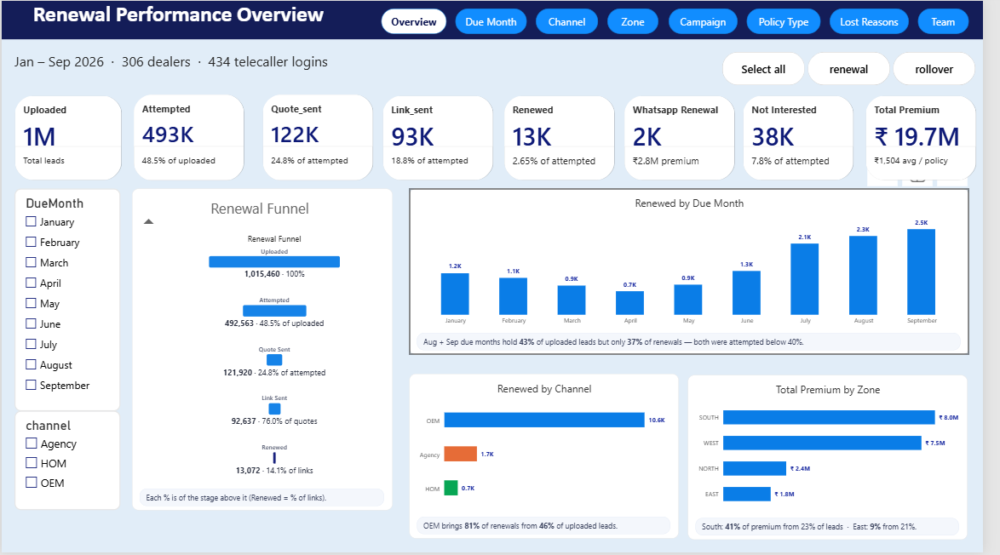

# 2W Insurance Renewal Performance Dashboard

A Power BI report that tracks two-wheeler (2W) insurance renewal performance for policies due January to September 2026. It follows about 1.02 million renewal leads from upload to call, quote, payment link and renewal, and shows where the funnel breaks by month, channel, zone, campaign, policy type, caller and dealer.



## What the report answers

- How many leads did we call, quote, send a payment link to and renew?
- Which months, channels, zones and campaigns are converting, and which are falling behind?
- Why do customers say no, and which callers and dealers need attention?

## Report pages

| Page | What it shows |
|---|---|
| **Overview** | Eight KPI cards (uploaded, attempted, quote sent, link sent, renewed, WhatsApp renewals, not interested, premium), the renewal funnel, renewals by due month and channel, and premium by zone |
| **Due Month** | Uploaded vs attempted by month with Attempt % labels, renewals by month and channel, a month-wise funnel table and the not-attempted backlog |
| **Channel** | OEM vs Agency vs HOM: renewals, link-to-renewal rate, a funnel per channel, premium share and a channel scoreboard |
| **Zone** | Zone tiles, a zone-to-state matrix with conditional formatting, and a zone manager ranking |
| **Campaign** | Renewal vs rollover campaign funnels, head-to-head comparison, lead mix by channel and last-call outcome by campaign |
| **Policy Type** | SAOD vs PACKAGE vs SATP performance and third-party-only demand |
| **Lost Reasons** | Why customers declined, first-call vs last-call outcomes |
| **Team** | Channel manager leaderboard, calls per attempted lead, top dealers and dealers needing attention |

Every page shares the same header, page-navigation buttons, slicers, campaign toggle and KPI row.

## Key definitions

| Measure | Formula |
|---|---|
| Uploaded | All leads |
| Attempt % | Attempted ÷ Uploaded |
| Quote % | Quote sent ÷ Uploaded |
| Conversion % | Renewed ÷ Attempted (blank when fewer than 10 attempted) |
| Link → Renewal % | Renewed ÷ Payment links sent |
| Avg Premium | Average premium of renewed policies |

All DAX measures, calculated columns and the Power Query steps are in [docs/measures.md](docs/measures.md).

## Key findings (Jan–Sep 2026)

- **Half the leads were never called.** 48.5% of 1.02M leads got at least one call; 2.65% of called leads renewed; ₹19.7M premium at about ₹1,504 per policy.
- **Timing is the biggest lever.** 39% of first calls happened on or after the policy due date, when about 1% renew. First calls made 8 or more days early renew at 4–7%.
- **Peak months outgrew the team.** In August–September, leads were 2.8× higher and many files arrived late, but callers grew only 24%. Attempt % fell to 37–39%.
- **Weak follow-through.** 127K customers who missed the first call were never called again, and only 22% of customers who said "Confirmed" actually renewed.
- **Channels break at different steps.** OEM brings 81% of renewals. Agency sends many payment links, but only 2.8% of them renew. HOM rarely sends a quote.
- **Price is rarely the reason.** "Already renewed" is the top reason customers give. Only about 1,500 cited a high premium.

The full business story, with root causes and a 90-day action plan, is in [docs/insights-deck.pdf](docs/insights-deck.pdf).

## Techniques used

- **Power Query:** type cleanup, a month-number column for correct month sorting, and a rule that marks renewals with a premium but a "NO" flag as renewed.
- **DAX:** `CALCULATE`, `DIVIDE`, variables, `SWITCH`, `TOPN` + `CONCATENATEX` for dynamic chart notes, measure-driven label colours and minimum-volume guards.
- **SVG visuals built in DAX:** funnels, zone tiles and bar panels rendered as images in Table and Matrix visuals (Data category = Image URL).
- **Report design:** page-navigation buttons, synced slicers, rule-based conditional formatting, data bars, custom tooltips and chart notes.

## Repository structure

```
2W-Insurance-Renewal-Dashboard/
├── README.md
├── .gitignore
├── powerbi/                     Power BI project (.pbip): report and model as text files
│   ├── 2W_Insurance_Renewal.pbip
│   ├── 2W_Insurance_Renewal.Report/
│   └── 2W_Insurance_Renewal.SemanticModel/
├── data/
│   └── sample_data.csv          10,000 anonymised rows with the same 38 columns
└── docs/
    ├── measures.md              all DAX measures and Power Query steps
    ├── dashboard.pdf            all report pages
    ├── insights-deck.pdf        business story and action plan
    └── screenshots/
```

## How to open the report

1. Install [Power BI Desktop](https://www.microsoft.com/power-platform/products/power-bi/desktop) (free, Windows).
2. Clone or download this repository.
3. Open `powerbi/2W_Insurance_Renewal.pbip`.
4. Go to **Home → Transform data → Data source settings → Change Source**, and browse to `data/sample_data.csv` in your copy of the repository.
5. Click **Close & Apply**, then **Refresh**.

The sample has 10,000 rows, so the numbers will be smaller than the findings above, but every page and measure works.

## About the data

Each row is one renewal lead. Columns used include the policy due date and due month, call status, attempt count, first and last call outcome, quote, payment link and renewal flags, premium, channel (OEM, Agency, HOM), campaign (renewal, rollover), policy type (SAOD, PACKAGE, SATP), and dealer, zone, state and manager hierarchy.

The full dataset (about 1.02M rows, 291 MB) is not included. It is too large for GitHub and contains confidential business data. In `data/sample_data.csv`, all IDs, caller logins, dealer names and manager names are replaced with placeholders.

## Screenshots

| Overview | Due Month |
|---|---|
|  |  |
| **Channel** | **Zone** |
|  |  |
| **Campaign** | **Policy Type** |
|  |  |
| **Lost Reasons** | **Team** |
|  |  |

## Author

Satish: Power BI report, data modelling and analysis.
